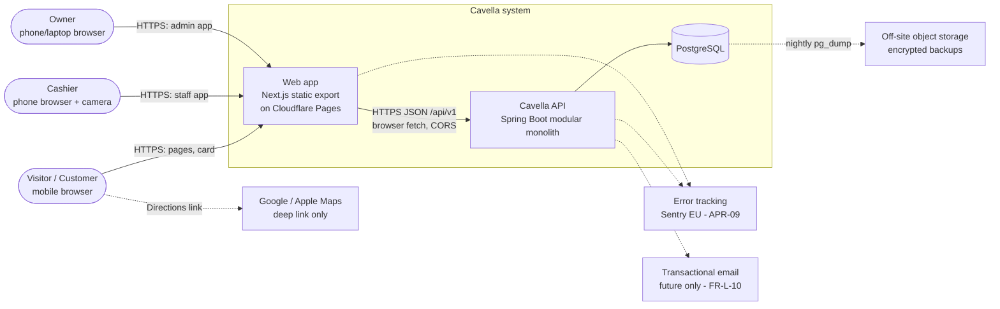
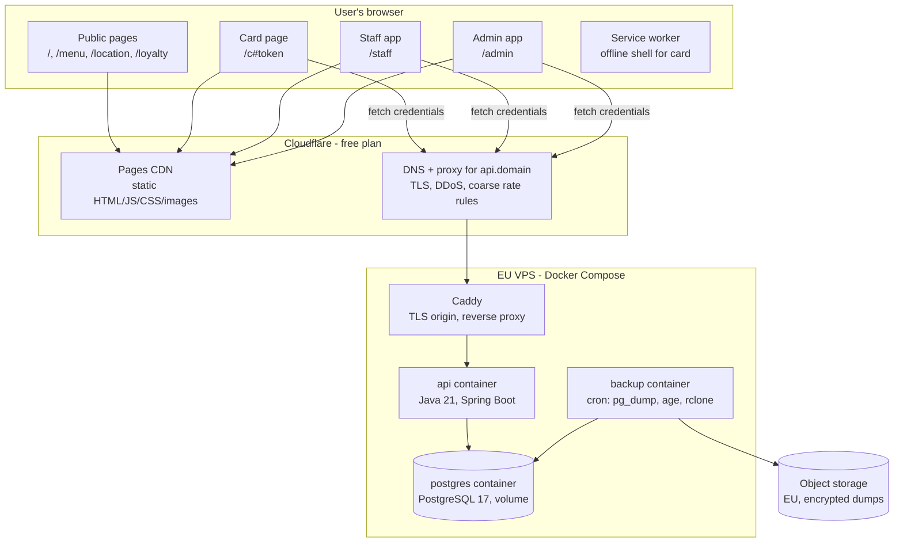
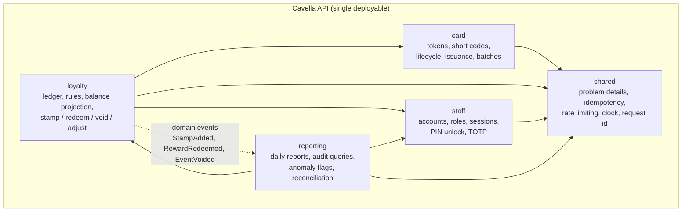
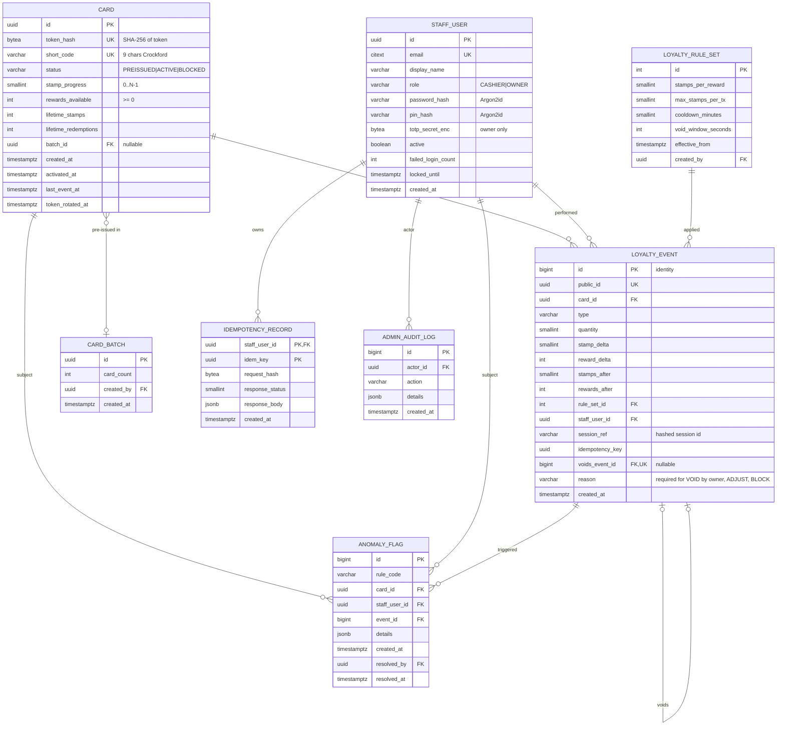
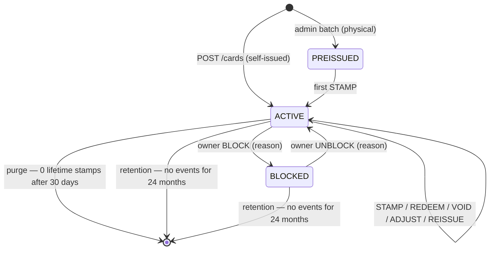
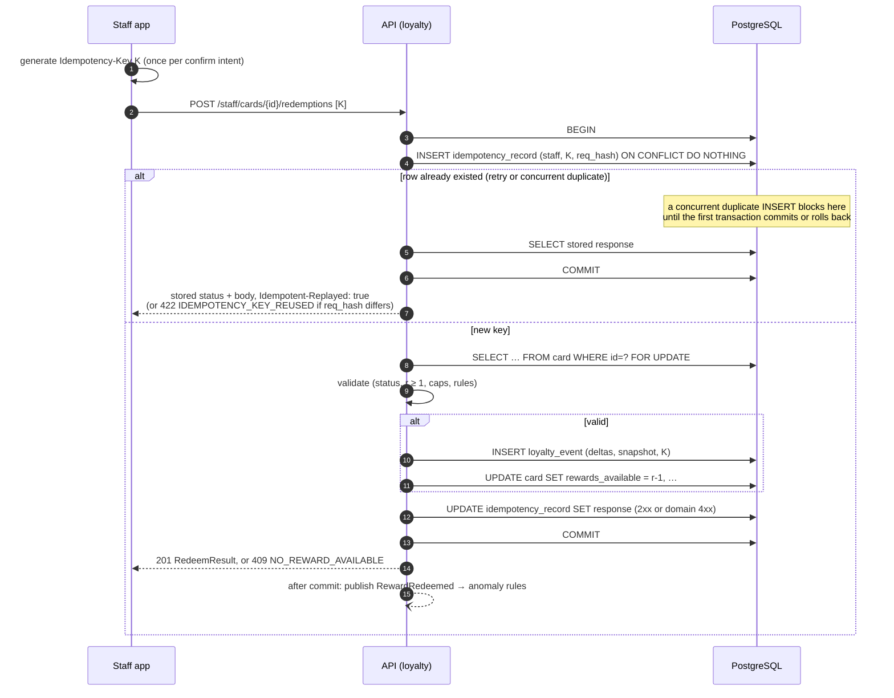

# Cavella — Architecture

| | |
|---|---|
| **Status** | Proposed v0.1, awaiting approval of the items in §0 |
| **Date** | 2026-11-01 |
| **Inputs** | [`docs/PRD.md`](PRD.md) v0.1 |
| **Related ADRs** | [ADR-001 Technology stack](ADR/001-technology-stack.md) · [ADR-002 Loyalty card identity](ADR/002-loyalty-card-identity.md) |
| **Style** | Modular monolith. One deployable backend, one statically exported frontend, one PostgreSQL database. |

Requirement IDs (`FR-`, `BR-`, `NFR-`, `AC-`, `T-`, `E-`, `D-`) refer to the PRD. Decisions that need the owner's sign-off are tagged **`[APR-nn]`** and collected in §0.

**Coverage of the requested topics:**
1. System context and component diagrams → §2
2. Frontend/backend responsibilities → §3
3. Domain model and database schema → §4
4. API contracts and error responses → §5
5. QR card identity and recovery → §6 (detail in ADR-002)
6. Staff authentication and authorisation → §7
7. Loyalty stamp and reward state transitions → §8
8. Transaction boundaries and concurrency → §9
9. Idempotency and anti-fraud controls → §10
10. Deployment, cost and operational tradeoffs → §11

Testing strategy and repository layout are in §12–§13.

---

## 0. Decisions requiring your approval

| ID | Decision | Recommendation | If you disagree |
|---|---|---|---|
| **APR-01** | Hosting topology | Web on **Cloudflare Pages** (free CDN). API and Postgres on **one EU VPS** (Hetzner or OVH, ~€5–8/mo) with Docker Compose. §11 | Put everything on the VPS (simpler, but the site goes down with the VPS), or a managed PaaS (about 2–4× the cost) |
| **APR-02** | Web rendering mode | Next.js **static export**. Menu and hours live in the repo as typed content files, and changing them means a redeploy (PRD D-08 option a). §3 | Run a Next server (SSR/ISR) on the VPS so the owner can edit content live. That adds a Node process and a second runtime to operate |
| **APR-03** | Card identity | A **random 128-bit bearer token** in the URL **fragment** (`/c#<token>`). The server stores **only its hash**, so if a card's link is lost the card is lost, as the PRD already accepts. ADR-002 | A rotating QR code, which breaks printed and screenshot backups; or storing the token in plaintext so staff could re-show it |
| **APR-04** | Loyalty persistence model | An **append-only ledger plus a cached balance**, updated in the same transaction, with **pessimistic per-card locking**. §8–§9 | Plain counters (loses the audit guarantee) or full event sourcing (more complexity) |
| **APR-05** | How rewards are represented | A **counter** (`rewards_available`). This only works if rewards **don't expire** (PRD D-03) | If rewards expire, switch to one `reward` row per earned reward with `earned_at` and `expires_at` (+1 table, ~1 day of extra work) |
| **APR-06** | Void semantics | A void is **rejected if it would make a balance negative** (for example, voiding the 6th stamp after its reward was already redeemed). The owner then uses an **ADJUST** event with a reason. §8.4 | Allow negative balances (breaks BR-05), or cascade-void the redemption too (confusing at the counter) |
| **APR-07** | Staff authentication | Email + password (Argon2id), plus a **personal PIN to unlock after 5 min idle**, plus **TOTP for the owner**. Passkeys later. §7 | Passkeys from day one (better security, but adds onboarding friction and more frontend work) |
| **APR-08** | Build and versions | **Maven**. Pin Spring Boot to its current GA line, Java 21 LTS, PostgreSQL 17, Node LTS. Keep **JUnit 5 (Jupiter)** as requested, even if the chosen Spring Boot line manages a newer JUnit (ADR-001) | Gradle (Kotlin DSL); or accept whatever JUnit version Spring Boot manages |
| **APR-09** | Error tracking | **Sentry free tier (SaaS, EU region)**, with card tokens and cookies scrubbed. §11.5 | Self-hosted GlitchTip (more ops), or logs only |
| **APR-10** | Recovery objective | **RPO 24 h** from nightly encrypted `pg_dump` off-site. In a disaster, up to one day of stamps could be lost and would be re-entered via ADJUST. §11.4 | Add continuous WAL archiving (wal-g → object storage) for RPO of minutes. About €1–3/mo and ~½ day of setup |

**PRD decisions that block implementation (owner input needed before coding the loyalty module):**
- **D-01**: what counts as a qualifying purchase.
- **D-02**: which coffees can be taken as the reward.
- **D-03**: whether rewards accumulate or expire, and whether a customer can stamp and redeem in the same visit. This also decides APR-05.
- **D-05**: whether the staff phone is kiosk-owned or personal.
- **D-11**: how free coffees are treated for VAT and on the fiscal register (ask the accountant).

---

## 1. Architectural drivers

| Driver | Source | Architectural consequence |
|---|---|---|
| A double redemption or a stamp without a staff action must never happen | BR-01, BR-05, BR-06, AC-L-03–05 | One transactional database is the single source of truth. Per-card row lock. Idempotency records committed in the same transaction. No client-side authority. |
| The public site must be very fast and survive backend outages | NFR-P-01–04, NFR-R-03 | Static export on a CDN. No runtime dependency on the API for public pages. |
| Very low cost, tiny team | G4, NFR-O-01 | One VPS, one database, no broker or cache cluster. Free tiers for CDN, CI and monitoring. |
| Low volume | A-11 (≤ 2k cards, ≤ 500 events/day) | A single Postgres instance is oversized by ~1000×. No horizontal scaling design needed. |
| Instant staff revocation, audit trail | AC-S-03, FR-A-02 | Server-side sessions in Postgres. Append-only ledger. |
| Privacy by design, no cookie banner | NFR-C-01–03 | Anonymous cards. Token kept out of URLs sent to servers. No third-party embeds. |

**Explicit non-choices.** There are no microservices, Kafka, Redis or Kubernetes. Every concern those would address (async work, caching, rate limiting, sessions, scaling) is covered at this volume by Postgres and in-process Spring features. When to revisit is listed in §11.7.

---

## 2. System context and components

### 2.1 System context (C4 level 1)



The browser talks to the API directly. Cloudflare Pages serves only static files and runs no server code.

### 2.2 Containers and runtime (C4 level 2)



### 2.3 Backend modules (component view)

Package root `pl.cavella`. Module boundaries are checked by a **Spring Modulith** `ApplicationModules.of(CavellaApplication.class).verify()` test. A module may only use another module's public API package. Internals stay package-private.



| Module | Owns tables | Public API (to other modules) | Web endpoints |
|---|---|---|---|
| `card` | `card`, `card_batch` | `CardLookup` (by token hash / short code / id), `CardLifecycle` (activate, block, unblock, reissue) | `POST /cards`, `GET /cards/self`, admin batches/block |
| `loyalty` | `loyalty_event`, `loyalty_rule_set` | `LoyaltyCommands`, `BalanceQuery`; publishes domain events | staff stamps/redemptions/voids, admin void/adjust |
| `staff` | `staff_user`, `SPRING_SESSION*`, `admin_audit_log` | `CurrentStaff` (id, role), `StaffDirectory` | `/staff/auth/*`, admin staff management |
| `reporting` | `anomaly_flag` | — (leaf) | admin reports, events, anomalies |
| `shared` | `idempotency_record`, `event_publication` | infrastructure services | — |

`content` (menu, hours) is **not** a backend module in the MVP. It lives in `apps/web/content/*.ts` (APR-02). If PRD D-08(b) gets approved later, it becomes a fifth module that triggers a Cloudflare Pages deploy hook on save.

---

## 3. Frontend / backend responsibilities

**The rule:** the backend is the only authority on balances, rules, identity and permissions. The frontend renders, collects intent, and retries safely.

| Concern | Web (Next.js, TS, Tailwind) | API (Spring Boot) |
|---|---|---|
| Menu, hours, location, legal pages | Typed content files in the repo, rendered at build time. PL/EN under `/pl/…` and `/en/…`, with `hreflang` | — |
| Open-now indicator | Computed **client-side** in Europe/Warsaw time (via `Intl`) from the content file. Space reserved in the layout so there's no layout shift (CLS) | — |
| SEO / structured data | Build-time `schema.org` JSON-LD, sitemap, robots | — |
| Card creation | Calls `POST /cards`, stores the token in `localStorage`, sets `location.hash` | Generates the token and short code, stores the hash, rate-limits |
| Card QR rendering | **Generated on the device** from the token (a small QR library). Works offline | Never renders QR images for cards (except batch PDFs) |
| Card balance | Fetched with `X-Card-Token`. Last known value cached locally and shown as possibly out of date when offline (NFR-P-05) | Source of truth |
| QR scanning | `getUserMedia` + native `BarcodeDetector` where available, falling back to a WASM zxing decoder (iOS Safari lacks `BarcodeDetector`). Extracts the token from the URL fragment and validates its format | Validates and resolves the token or short code |
| Stamp/redeem confirm | Generates a UUIDv4 **idempotency key per confirm intent**, disables the button after the first tap, retries with the same key on network failure | Enforces idempotency, caps, cooldown, balance invariants |
| Authorisation | Hides UI by role (cosmetic only) | `@PreAuthorize` on every staff/admin endpoint (SEC-02) |
| Time | Displays relative times | All timestamps come from the server (`Clock` bean, `timestamptz`). Europe/Warsaw for day boundaries |
| Reports / PDF | Download links | CSV generation; batch PDF generation (OpenPDF + ZXing) |
| i18n | All UI strings. Error messages mapped from the API's `code` | Returns stable machine `code`s, with English `title` for developers only |

**Static-export constraints, accepted under APR-02:** no server components with request-time data, no Next API routes, no middleware. Dynamic data is fetched in the browser. Locale redirect at `/` is handled by a Cloudflare `_redirects` rule plus a client fallback.

**Service worker:** a minimal one, scoped to `/c`, caching the card shell so the QR and last known balance work during brief network loss. The staff app deliberately has **no offline mode** (PRD D-10, E-05).

---

## 4. Domain model and database schema

### 4.1 Domain model

- **Card**: an anonymous loyalty identity. Has a status, a token *hash*, a short code, and a balance projection (`stamp_progress`, `rewards_available`).
- **LoyaltyEvent**: an immutable ledger entry. Its `type` is one of STAMP, REDEEM, VOID, ADJUST, BLOCK, UNBLOCK, REISSUE. Every balance change is an event, and the balance is a projection of the events.
- **LoyaltyRuleSet**: versioned rule values (`stamps_per_reward` = 6, `max_stamps_per_tx`, `cooldown_minutes`, `void_window_seconds`). Exactly one is active at a time.
- **StaffUser**: an individual account with role CASHIER or OWNER.
- **Staff session**: server-side (Spring Session JDBC), indexed by principal so sessions can be revoked.
- **IdempotencyRecord**: the stored outcome of a staff command, keyed by `(staff_user_id, key)`.
- **AnomalyFlag**: an automated fraud signal for the owner to review.
- **CardBatch**: a group of pre-issued physical cards.
- **AdminAuditLog**: non-loyalty security events (logins, account changes, rule changes, session revocations).

### 4.2 Entity-relationship diagram



### 4.3 Integrity constraints (enforced in the database, not just in Java)

These rules are illustrative and will be written as Flyway migrations at implementation time.

| Constraint | Purpose |
|---|---|
| `card.rewards_available >= 0` (CHECK) | BR-05. The last line of defence against double redemption |
| `card.stamp_progress >= 0 AND stamp_progress < 32` (CHECK). The application keeps it `< stamps_per_reward` | Sanity bound. The exact upper bound depends on the rule, so it is checked in the domain and by reconciliation |
| `UNIQUE (card.token_hash)`, `UNIQUE (card.short_code)` | Identity |
| `UNIQUE (loyalty_event.voids_event_id)` (partial, non-null) | BR-08: an event can be voided only once |
| `UNIQUE (loyalty_event.staff_user_id, idempotency_key)` (partial, non-null) | A second guard behind the idempotency table |
| `loyalty_event`: no UPDATE/DELETE granted to the app role. Enforced via `REVOKE` plus a trigger that raises on UPDATE/DELETE | Append-only audit (FR-A-02) |
| `loyalty_event.type IN (...)` CHECK, `quantity BETWEEN 1 AND 10` | Domain validity |
| `PRIMARY KEY (idempotency_record.staff_user_id, idem_key)` | BR-06 |
| FK `card_id … ON DELETE CASCADE` on `loyalty_event` | Lets retention purges (§8.1) remove a card's history. Allowed only by the purge job's role or function |

**Indexes:** `loyalty_event (card_id, created_at DESC)` for the card page and staff summary; `loyalty_event (staff_user_id, created_at)` for per-cashier reports; `loyalty_event (created_at)` for daily reports; `card (status, last_event_at)` for purge jobs. Nothing more is needed at this volume.

**Conventions:**
- Timestamps are `timestamptz`, stored in UTC.
- Public identifiers are UUIDs (v7 where generated by the app).
- `loyalty_event.id` is a bigint identity, used internally for ordering.
- Migrations are named `V{n}__{description}.sql`, forward-only, using expand/contract for breaking changes.
- The `citext` extension is enabled for emails.

**Data sizing:** 2k cards × ~200 bytes plus ~180k events/year × ~150 bytes comes to well under 100 MB per year.

---

## 5. API contracts and error responses

### 5.1 Conventions
- Base URL `https://api.<domain>/api/v1`. JSON (UTF-8). camelCase fields. ISO-8601 timestamps with offset.
- **Versioning**: URL prefix `v1`. Additive changes don't bump the version.
- **Card authentication**: header `X-Card-Token: <token>`. The token **never** appears in a path or query string, so it never reaches access logs (§6).
- **Staff authentication**: session cookie `__Host-cavella_sid` (HttpOnly, Secure, SameSite=Strict, Path=/), plus header `X-CSRF-Token` on state-changing requests.
- **CORS**: allow only `https://<domain>` (and the staging origin), with `Allow-Credentials: true`. Allowed headers: `Content-Type, X-Card-Token, X-CSRF-Token, Idempotency-Key`.
- **Idempotency**: every staff POST that changes loyalty state **requires** `Idempotency-Key: <uuid>`. A missing key returns 400 `IDEMPOTENCY_KEY_REQUIRED`. A replayed response carries `Idempotent-Replayed: true`.
- **Caching**: every API response is `Cache-Control: no-store`.
- **Tracing**: every response carries `X-Request-Id`, which is also logged and attached to Sentry events.

### 5.2 Endpoints

**Public (card holder)**

| Method & path | Request | Success | Errors |
|---|---|---|---|
| `POST /cards` | `{}`. An optional `X-Card-Token` header lets the server reject the request with 409 `CARD_ALREADY_PRESENT` if the device already holds a valid card | `201 {token, shortCode, card: CardView}`. **The token is returned only once, in this response** | 429 `RATE_LIMITED` |
| `GET /cards/self` | header `X-Card-Token` | `200 CardView` | 404 `CARD_NOT_FOUND` (also returned for a malformed token), 429 |

`CardView = { shortCode, status, stampProgress, stampsPerReward, rewardsAvailable, recentEvents: [{type, quantity, at}] (max 5), terms: {version, url} }`. It contains no internal IDs, no staff names, and no exact history beyond 5 entries (T-10).

**Staff (role CASHIER or OWNER)**

| Method & path | Request | Success | Errors |
|---|---|---|---|
| `GET /staff/auth/csrf` | — | `200 {token}` | — |
| `POST /staff/auth/login` | `{email, password}` | `200 {staff: StaffView, mfaRequired: false}`, or `{mfaRequired: true}` with a pre-auth session (owner) | 401 `INVALID_CREDENTIALS`, 423 `ACCOUNT_LOCKED`, 429 |
| `POST /staff/auth/totp` | `{code}` | `200 {staff}` | 401 `INVALID_TOTP` |
| `POST /staff/auth/unlock` | `{pin}` | `204` | 401 `INVALID_PIN` (after 5 failures the session is destroyed) |
| `POST /staff/auth/logout` | — | `204` | — |
| `GET /staff/me` | — | `200 StaffView` | 401 `UNAUTHENTICATED` / `SESSION_LOCKED` |
| `POST /staff/cards/lookup` | `{token}` **or** `{shortCode}` | `200 CardSummary` | 404 `CARD_NOT_FOUND`, 429 (short-code path: 10/min/session, AC-L-11) |
| `POST /staff/cards/{cardId}/stamps` | `{quantity}` + `Idempotency-Key` | `201 StampResult` | 404, 409 `CARD_BLOCKED`, 422 `QUANTITY_EXCEEDS_CAP`, 422 `IDEMPOTENCY_KEY_REUSED` |
| `POST /staff/cards/{cardId}/redemptions` | `{}` + `Idempotency-Key` | `201 RedeemResult` | 404, 409 `CARD_BLOCKED`, 409 `NO_REWARD_AVAILABLE`, 422 |
| `POST /staff/events/{eventId}/void` | `{reason?}` + `Idempotency-Key` | `201 VoidResult` | 403 `VOID_WINDOW_EXPIRED` / `NOT_EVENT_OWNER`, 409 `ALREADY_VOIDED`, 409 `VOID_WOULD_GO_NEGATIVE`, 409 `RULES_CHANGED_SINCE_EVENT` |
| `GET /staff/shift-summary` | — | `200 {stampsToday, redemptionsToday, voidsToday}` (Europe/Warsaw day) | — |

`CardSummary = { cardId, shortCode, status, stampProgress, stampsPerReward, rewardsAvailable, lastEventAt, warnings: [RECENT_STAMP|NEW_CARD|FLAGGED|PREISSUED] }`. `cardId` is an internal UUID. It is useless without a staff session, and is used for follow-up commands so that the bearer token isn't sent twice.

`StampResult = { eventId, card: CardSummary, rewardsEarned: int, warnings: [COOLDOWN_EXCEEDED] }`. With D-07's default, a cooldown hit is a **warning plus an anomaly flag, not a rejection**.

**Admin (role OWNER only)**

| Method & path | Purpose |
|---|---|
| `GET/POST /admin/staff`, `PATCH /admin/staff/{id}` | List and create staff, change role, activate or deactivate (deactivating revokes all sessions), reset password, PIN or TOTP |
| `DELETE /admin/staff/{id}/sessions` | Revoke all sessions now (AC-S-03) |
| `POST /admin/cards/{cardId}/block` · `/unblock` | `{reason}` (FR-A-05) |
| `POST /admin/cards/{cardId}/reissue` | Rotates the token and returns a new card URL once, as JSON with a QR. The old token stops working (ADR-002) |
| `POST /admin/cards/{cardId}/adjustments` | `{stampDelta, rewardDelta, reason}` + `Idempotency-Key`. Covers E-05, E-12 and APR-06 |
| `POST /admin/events/{eventId}/void` | `{reason}` (required). No time window |
| `GET /admin/events?from&to&staffId&cardId&type&cursor` | Audit log, cursor-paginated (FR-A-02) |
| `GET /admin/reports/daily?date=` · `…/daily.csv` | FR-A-03 |
| `GET /admin/anomalies?status=open` · `POST /admin/anomalies/{id}/resolve` | FR-A-06 |
| `POST /admin/card-batches` `{count ≤ 200}` | Returns `application/pdf` **once**. Only hashes are stored, so tokens can't be regenerated (FR-L-07) |
| `GET/POST /admin/rules` | View the active rule set and create a new version (FR-A-07) |

### 5.3 Error format (RFC 9457 Problem Details)

```http
HTTP/1.1 409 Conflict
Content-Type: application/problem+json
X-Request-Id: 01JC9W3B7Q2Z8V5K6T4R1M0N9P

{
  "type": "https://<domain>/problems/no-reward-available",
  "title": "No reward available",
  "status": 409,
  "code": "NO_REWARD_AVAILABLE",
  "detail": "Card has 0 rewards available.",
  "instance": "/api/v1/staff/cards/5f0c…/redemptions",
  "requestId": "01JC9W3B7Q2Z8V5K6T4R1M0N9P",
  "card": { "stampProgress": 2, "rewardsAvailable": 0 }
}
```

- `code` is the stable contract. The web app maps it to localised text and a UI state (AC-S-02).
- `title` and `detail` are English and meant for developers.
- Validation errors add `errors: [{field, code}]`.
- Domain errors may include the current `card` so the UI can update without another request.
- 5xx responses never expose stack traces or SQL.

| HTTP | Codes | Retry? |
|---|---|---|
| 400 | `VALIDATION_FAILED`, `IDEMPOTENCY_KEY_REQUIRED` | No (client bug) |
| 401 | `UNAUTHENTICATED`, `SESSION_LOCKED`, `INVALID_CREDENTIALS`, `INVALID_TOTP`, `INVALID_PIN` | After re-auth or unlock |
| 403 | `FORBIDDEN`, `CSRF_INVALID`, `VOID_WINDOW_EXPIRED`, `NOT_EVENT_OWNER` | No |
| 404 | `CARD_NOT_FOUND`, `EVENT_NOT_FOUND` | No |
| 409 | `CARD_BLOCKED`, `NO_REWARD_AVAILABLE`, `ALREADY_VOIDED`, `VOID_WOULD_GO_NEGATIVE`, `RULES_CHANGED_SINCE_EVENT`, `CARD_ALREADY_PRESENT` | No (business outcome) |
| 422 | `QUANTITY_EXCEEDS_CAP`, `IDEMPOTENCY_KEY_REUSED` | No |
| 423 | `ACCOUNT_LOCKED` | After `Retry-After` |
| 429 | `RATE_LIMITED` | After `Retry-After` |
| 5xx / network | `INTERNAL_ERROR`, `SERVICE_UNAVAILABLE` | **Yes, with the same `Idempotency-Key`** (E-01) |

---

## 6. QR card identity and recovery

Summary of [ADR-002](ADR/002-loyalty-card-identity.md) **[APR-03]**.

- **Token**: 16 bytes from `SecureRandom`, base64url-encoded (22 chars, 128 bits). Possession of the token is the card.
- **QR payload / card URL**: `https://<domain>/c#<token>`, about 43–50 characters, which needs QR version 4 (33×33 modules) at error-correction level M (version 3 holds only 42 bytes; corrected 2026-11-02). That still gives large modules that scan easily from a dim or cracked screen. The **fragment is never sent to any server**, so it doesn't appear in Cloudflare or Caddy logs or `Referer` headers. The web app reads it from `location.hash` and sends it only in the `X-Card-Token` header.
- **Storage**: the server keeps only `SHA-256(token)`. A slow hash isn't needed because the token has 128 bits of entropy. A leaked database therefore doesn't leak usable cards. The device keeps the token in `localStorage` and in the bookmarked or home-screen URL.
- **Short code**: 40 random bits as 8 Crockford Base32 characters plus 1 check character, displayed as `K7M2-QX9P-3`. It is a **separate random value**, not derived from the token. It is accepted **only** on the staff lookup endpoint, rate-limited and logged (T-03). With ≤ 2k cards in a space of 2⁴⁰, a successful blind guess has probability ~2⁻²⁹ per attempt.
- **Scanner validation**: the staff app accepts only a URL with host `<domain>` (or staging), path `/c` and a fragment matching `^[A-Za-z0-9_-]{22}$`. Anything else shows "Not a Cavella card" (E-18).
- **Recovery**, without personal data:
  1. Any copy of the URL or QR restores the card: bookmark, home-screen icon, screenshot, printed card.
  2. The card page has a **"Save / move my card"** panel with copy-link, share-sheet (`navigator.share`) and "show QR to scan with your new phone".
  3. **Reissue**: if a customer believes their card was copied, staff scan it and the owner reissues it. The token rotates, the balance is kept, and the old token dies.
  4. Opt-in email recovery is future work (FR-L-10).
  5. Otherwise a lost card stays lost. This is stated clearly in the UI and *regulamin*, consistent with PRD J8.
- **Physical cards**: batch-generated as PREISSUED. The PDF is produced once and tokens are never stored. They activate on their first stamp.
- **⚠ Pre-implementation spike (1 day)**: on iOS, a home-screen web app has **separate storage from Safari** and launches the manifest's `start_url`, which can't contain a per-card token. The spike must confirm the pattern of omitting `start_url` and the manifest on `/c` so iOS bookmarks the current URL including the fragment. Fallback: a "paste your card link" first-run screen in standalone mode. **Acceptance:** on iOS and Android, adding the card to the home screen and reopening it from the icon shows the same card.

---

## 7. Staff authentication and authorisation

Summary **[APR-07]**:

| Aspect | Design |
|---|---|
| Framework | Spring Security 6+, session-based (no JWT: sessions must be revocable instantly) |
| Session store | **Spring Session JDBC** in Postgres. `FindByIndexNameSessionRepository` makes "revoke all sessions for a user" one query. Each request validates the session against the DB, which costs about 1 ms at this volume. No Redis |
| Cookie | `__Host-cavella_sid`, HttpOnly, Secure, SameSite=Strict. The web app (`<domain>`) and API (`api.<domain>`) are **same-site**, so the cookie is sent with `credentials: 'include'` and third-party cookie blocking doesn't apply |
| CSRF | Spring Security CSRF tokens (header `X-CSRF-Token`). Defence in depth on top of SameSite=Strict and the strict CORS origin |
| Passwords | Argon2id (Spring `Argon2PasswordEncoder`), minimum 12 characters, checked against a top-10k common-password list. Owner-initiated reset generates a one-time password that must be changed at first login |
| Session lifetime | Absolute expiry of 12 h (`[PLACEHOLDER]`, PRD FR-S-02). **Idle lock after 5 min**: the session is marked `LOCKED` server-side, every request returns 401 `SESSION_LOCKED`, and `POST /staff/auth/unlock {pin}` with the user's 4–6 digit PIN re-opens it. Five wrong PINs destroy the session. This keeps the shared kiosk phone safe when it's left on the counter, without a full password re-login each time (D-05) |
| MFA | TOTP (RFC 6238) **required for OWNER**. The secret is encrypted with an app key from an environment secret. Cashiers don't use TOTP: their blast radius is capped by limits and audit, and speed at the counter matters |
| Brute force | Per-account counter: 5 failures in 15 min → `locked_until` = now + 15 min (AC-S-07). Plus a per-IP limit of 20/min |
| Roles | `CASHIER`: lookup, stamp, redeem, void **own** events within the window, own shift summary. `OWNER`: everything, including admin endpoints. Enforced by `@PreAuthorize` on application services, not just on controllers |
| Revocation | Deactivating a user or revoking sessions deletes their session rows. The next request fails immediately (AC-S-03 target ≤ 60 s, actual: immediate) |
| Audit | Login success/failure, unlock failure, MFA events, account and role changes and rule changes go to `admin_audit_log` |
| Future | Passkeys (WebAuthn) as an alternative to passwords. Spring Security has built-in support, so the swap stays local to the `staff` module |

The **customer side has no authentication**: `X-Card-Token` is a capability, not a login. The two security domains never mix. Card endpoints are read-only plus creation, so a card token can never authorise a write (BR-01, AC-L-03).

---

## 8. Loyalty stamp and reward state transitions

### 8.1 Card lifecycle



- PREISSUED cards are exempt from the 30-day empty purge (PRD E-19). They are purged after 24 months unused.
- REDEEM, VOID and ADJUST are rejected on PREISSUED cards because they have no balance yet.
- A BLOCKED card rejects STAMP, REDEEM and staff VOID. The owner can still VOID or ADJUST with a reason.
- **Purges hard-delete the card and its events**, as required by the retention promise (NFR-C-04). Daily report aggregates already exported are not affected.

### 8.2 Balance state and transitions

The balance state is `(p, r)`: stamp progress `0 ≤ p < N` and rewards available `r ≥ 0`, where `N` = `stamps_per_reward` of the active rule set (6).

| Command | Precondition | Transition | Event |
|---|---|---|---|
| STAMP *q* | status ∈ {ACTIVE, PREISSUED}; `1 ≤ q ≤ max_stamps_per_tx` | `t = p + q`; `r' = r + ⌊t/N⌋`; `p' = t mod N`; PREISSUED → ACTIVE | `STAMP(q, stamp_delta=p'-p, reward_delta=⌊t/N⌋)` |
| REDEEM | ACTIVE; `r ≥ 1` | `r' = r - 1` | `REDEEM(reward_delta=-1)` |
| VOID *e* | *e* not voided; *e* ∈ {STAMP, REDEEM, ADJUST}; cashier: own event and within the void window; owner: any, with reason; *e* used the current rule set | Apply the inverse of *e*'s deltas with borrowing (below). **Reject if `r' < 0`** **[APR-06]** | `VOID(voids_event_id=e)` |
| ADJUST *(Δp, Δr)* | owner; reason | Normalise `p + Δp` into `[0, N)`, carrying into or borrowing from `r`. Reject if `r' < 0` | `ADJUST` |
| BLOCK / UNBLOCK / REISSUE | owner; reason | Status or token change only | corresponding event |

**Voiding a STAMP of q:** `t = p - q`. While `t < 0`: `t += N; r -= 1`. Then `p' = t`, and reject if `r < 0`.

*Example:* the card is at `(5, 0)`. A STAMP of 2 gives `t = 7`, so the result is `(1, 1)` with one reward earned. Voiding that stamp gives `t = -1`, which borrows back to `(5, 0)`. That's allowed. But if the reward was redeemed first, the state is `(1, 0)`, the void would need `r = -1`, and it is **rejected with `VOID_WOULD_GO_NEGATIVE`**. The UI then tells the cashier to ask the owner, who can void the REDEEM first or record an ADJUST.

**Voiding a REDEEM:** `r' = r + 1`.

**Rule changes** (for example N = 6 → 8, FR-A-07): a new rule-set row is created and applies to later commands. Existing `(p, r)` is kept. If `p ≥ N_new`, it is normalised once by a migration-style job that writes ADJUST events (PRD E-14 "progress kept"). Voiding events made under an older rule set is rejected (`RULES_CHANGED_SINCE_EVENT`), and the owner uses ADJUST instead. This avoids mixing two values of N in reversal math.

**The same visit** (PRD E-04) is two independent commands: STAMP, then REDEEM. Both are allowed unless D-03 says otherwise. If it does, a REDEEM within *x* minutes of the STAMP that earned the reward is rejected by rule.

### 8.3 Reward representation **[APR-05]**

A counter (`rewards_available`) is enough as long as rewards **don't expire** (D-03 default). If expiry is approved, add `reward(id, card_id, earned_event_id, expires_at, redeemed_event_id)`. REDEEM then consumes the oldest unexpired reward, and a nightly job writes EXPIRE events. The ledger and locking design stays the same.

### 8.4 Implementation choices for the loyalty domain

#### Option A: Mutable counters plus a separate audit table

`UPDATE card SET rewards_available = rewards_available - 1 WHERE id = ? AND rewards_available > 0`, with the audit row written separately.
- ➕ Simplest code. The conditional UPDATE is atomic on its own.
- ➖ The balance and audit trail are **two independent truths** that can drift (a missed audit insert, a manual SQL fix). Voids need hand-written reversal with no record of which deltas were applied. The anomaly reconciliation PRD T-05 relies on would have nothing authoritative to reconcile against. Explaining "why does this card have 3 rewards?" relies on trust.

#### Option B: Full event sourcing

The balance is never stored. It is computed by folding the card's events on every read, either by hand or with a framework such as Axon.
- ➕ One truth. A perfect audit. Rule-replay possible.
- ➖ Concurrency needs per-stream optimistic versioning (expected-version on append) or a lock anyway. Every read folds history (cheap here, but adds code). A framework like Axon brings its own server or event store, snapshots, upcasting and a learning curve. That is far beyond a single kiosk's needs. Reporting queries get harder.

#### Option C (recommended **[APR-04]**): Append-only ledger plus a transactional balance projection

Each command, in **one DB transaction**, locks the card row, validates against the projection, **inserts the ledger event** carrying `stamp_delta`, `reward_delta` and the `stamps_after`/`rewards_after` snapshot, and **updates the card's projection columns**.
- ➕ The ledger is the audit truth, and the projection is a cache that is guaranteed consistent because it is written in the same transaction. Reads are a single row. DB CHECK constraints catch logic bugs. Voids are simple because the deltas are recorded. A **nightly reconciliation job** re-folds each card's ledger and compares it with the projection. Any mismatch raises an anomaly flag and alerts the owner. It never auto-fixes.
- ➖ The balance logic touches two tables, which is covered by tests. Snapshots duplicate a little data.

| Criterion | A: Counters | B: Event sourcing | **C: Ledger + projection** |
|---|---|---|---|
| Double-redemption safety | ✅ conditional UPDATE | ✅ with versioning | ✅ row lock + CHECK |
| Audit is authoritative | ❌ separate, can drift | ✅ | ✅ |
| Void correctness | ⚠ ad hoc | ✅ | ✅ recorded deltas |
| Read cost | 1 row | fold N events | 1 row |
| Code / concept complexity | Low | High | **Low–medium** |
| Extra infrastructure | None | Event store / framework | None |
| Reconciliation possible | ❌ | n/a | ✅ nightly |

**Recommendation: C.** It costs about the same to build as A, but gives the audit and correctness guarantees of B without a framework or event store.

---

## 9. Transaction boundaries and concurrency

### 9.1 Boundaries
- **One command = one database transaction = one HTTP request.** It is implemented as a `@Transactional` application service in the `loyalty` module. No distributed transactions, no sagas: everything lives in one database.
- **Isolation: READ COMMITTED** (Postgres default) plus an explicit **pessimistic row lock** on the card. SERIALIZABLE isn't needed because every invariant is scoped to one card row, which the lock serialises.
- **Inside the transaction:** the idempotency record, card lock, rule validation, event insert, projection update and response storage.
- **Outside, after commit:** anomaly evaluation and the response to the client. Anomaly evaluation goes through Spring Modulith's JDBC **event publication registry**, giving at-least-once delivery to `@TransactionalEventListener(AFTER_COMMIT)` handlers in `reporting`, with no broker. If the process crashes, incomplete publications are resubmitted at startup. The nightly sweep is a backstop.

### 9.2 Stamp/redeem sequence



### 9.3 Concurrency options considered

| Option | How it works | Verdict |
|---|---|---|
| **Pessimistic `SELECT … FOR UPDATE`** on the card row | The second concurrent command on the same card waits (milliseconds), then sees the updated balance | **Chosen.** Contention is effectively zero (one card is served at a time). Deterministic, no retry loop, easy to test (AC-L-05) |
| Optimistic `version` column | The loser gets an optimistic-lock failure and retries | Works, but needs retry logic for no gain at this contention level |
| SERIALIZABLE isolation | Postgres SSI detects conflicts, and the loser retries | Same retry burden, and harder to reason about |
| Conditional UPDATE only (`WHERE rewards_available > 0`) | Atomic decrement | Good for a single counter, but the ledger insert and multi-field logic still need the row to be stable. Kept as a **second guard** through the CHECK constraint |

**Lock ordering:** each command locks exactly one card row, so deadlocks are impossible. Admin batch operations lock cards in ascending `id` order. **Timeouts:** `lock_timeout = 3s` and `statement_timeout = 5s` for the app role. A lock timeout returns 503 `SERVICE_UNAVAILABLE`, which the client retries safely with the same key.

### 9.4 Card creation
`POST /cards` inserts one row. A short-code collision (a unique violation, astronomically rare) is retried up to 3 times with a new code. Token hash collisions are cryptographically negligible.

---

## 10. Idempotency and anti-fraud controls

### 10.1 Idempotency (BR-06)
- **Key scope**: `(staff_user_id, Idempotency-Key)`. One cashier's keys can't collide with or replay another's.
- **Key generation**: the staff app creates a UUIDv4 when it shows a confirm action (for example "Add 1 stamp to card X") and reuses it for every retry of *that* intent. A new scan or a changed quantity creates a new key.
- **Request fingerprint**: `request_hash = SHA-256(method ‖ path ‖ canonical JSON body)`. The same key with a different body returns 422 `IDEMPOTENCY_KEY_REUSED`, which protects against client bugs.
- **What is stored**: final 2xx and **domain 4xx** outcomes, so a replay is deterministic even if state has changed since. 5xx and lock timeouts roll the transaction back, so no record remains and a retry executes fresh, which is correct.
- **Concurrent duplicates**: handled by Postgres unique-index semantics. The second `INSERT … ON CONFLICT DO NOTHING` **waits** for the first transaction. If that commits, the second sees the row and replays. If it rolls back, the second proceeds. No `IN_PROGRESS` state and no distributed lock needed.
- **Retention**: records are purged after 7 days by a daily job. Retry windows are seconds, so 7 days is generous.
- **UI**: the confirm button is disabled on first tap, a "Checking…" state shows while retrying, and only the final server result is shown (E-01, E-02).

### 10.2 Anti-fraud controls

| Threat (PRD §6) | Preventive control | Detective control |
|---|---|---|
| T-01 self-stamping | No write endpoint accepts a card token. Every write requires a staff session and CSRF token | AC-L-03 automated test over every route |
| T-02 double redemption | Row lock, `r ≥ 1` validation, CHECK `r ≥ 0`, idempotency | Reconciliation job |
| T-03 token guessing | 128-bit token. Short code accepted only from staff, rate-limited. Uniform 404 | `MANUAL_LOOKUP_MISSES` anomaly rule |
| T-04 copied QR | Accepted risk (ADR-002). Owner can reissue the card | Staff summary shows `lastEventAt` |
| T-05 dishonest cashier | Per-tx cap (server-side), void window, own-events-only voids, individual accounts | Anomaly rules (below), per-cashier daily CSV, owner reconciles stamps against fiscal-register coffee count. **Residual risk until POS integration (F-F-01)** |
| T-06 stolen staff credentials or phone | Argon2id, lockout, idle PIN lock, 12 h expiry, instant revoke, owner TOTP | Login audit, anomaly rules |
| T-07 card spam | Per-IP limit on `POST /cards` (5/h), Cloudflare rule, 30-day empty purge. Add Cloudflare Turnstile only if abuse is observed | Daily new-cards metric |
| T-08 replay | TLS + HSTS. Idempotency keys are single-use per staff user. CSRF | — |
| T-09 XSS | No user-generated HTML anywhere. React escaping. Strict CSP on Pages (`_headers`): `default-src 'self'`, `connect-src` the API origin, no inline script except hashed JSON-LD | CSP report-only in staging first |

**Anomaly rules** (module `reporting`, evaluated after commit and swept nightly; thresholds are rule-set config):

| Rule code | Condition |
|---|---|
| `CARD_DAILY_STAMPS` | A card gets more than 6 stamps in one Europe/Warsaw day |
| `COOLDOWN_EXCEEDED` | More than `max_stamps_per_tx` stamps on one card within the cooldown window |
| `NEW_CARD_MAX_STAMPS` | A card less than 5 minutes old gets the per-transaction maximum |
| `QUICK_SELF_REDEEM` | The same cashier stamps the reward-completing stamp and redeems it within 5 minutes |
| `CASHIER_RATE` | A cashier exceeds X stamps/hour, or is above 2× the median share for the shift |
| `OFF_HOURS` | An event outside opening hours ± 30 min (hours mirrored into config) |
| `MANUAL_LOOKUP_MISSES` | 5 or more not-found short-code lookups per session per 10 minutes |
| `PROJECTION_MISMATCH` | Reconciliation found the ledger fold ≠ the card projection |

**Rate limiting:** Bucket4j with in-memory (Caffeine) buckets keyed by IP or staff user. In-memory is acceptable because there's a **single API instance** and rate limits are best-effort friction, not a correctness control. The correctness controls all live in the database. The client IP comes from `CF-Connecting-IP`, trusted only when the request arrives from Cloudflare IP ranges (Caddy `trusted_proxies`).

**Log hygiene (SEC-03):**
- A logging filter redacts the `X-Card-Token`, `Cookie` and `X-CSRF-Token` headers.
- Sentry `beforeSend` scrubs the same fields and `location.hash` on the web side.
- The card page sets `Referrer-Policy: no-referrer`.

---

## 11. Deployment, cost and operations

### 11.1 Recommended topology **[APR-01]**

| Component | Where | Notes |
|---|---|---|
| Web (all routes) | **Cloudflare Pages** (free) | Global CDN, automatic TLS, preview deployments per PR, `_headers` for CSP/HSTS, `_redirects` for locale |
| DNS + API proxy | Cloudflare free plan | Hides the origin IP, absorbs junk traffic, coarse rate rules. Full (strict) TLS to the origin |
| API + DB | **One VPS**, EU (Hetzner Falkenstein/Nuremberg/Helsinki, or OVH Warsaw/Gravelines), 2 vCPU / 4 GB | Docker Compose: `caddy`, `api` (JRE 21, `-XX:MaxRAMPercentage=60`, Spring AOT/CDS for a faster start), `postgres:17` (named volume), `backup` |
| Backups | Object storage (Hetzner Storage Box or Backblaze B2 EU) | Nightly `pg_dump -Fc`, encrypted with `age`, uploaded with `rclone`. Kept 14 daily + 8 weekly (SEC-06) |
| CI/CD | GitHub Actions (free tier) | See §11.3 |
| Monitoring | Better Stack or UptimeRobot (free) on `/actuator/health/readiness`, plus Sentry (APR-09) | Alerts to the owner by email or push |

### 11.2 Alternatives compared

| | **1. Pages + VPS (recommended)** | 2. Everything on the VPS (Next server + API + DB) | 3. Managed PaaS (e.g. Render/Fly/Railway) + managed Postgres (Neon/Supabase) |
|---|---|---|---|
| Public site survives API/VPS outage | ✅ (NFR-R-03) | ❌ | ✅ / ⚠ depends |
| Public site speed | ✅ edge CDN | ⚠ single origin (CF cache helps) | ✅ |
| Ops burden | Medium-low: OS updates, Compose, backups | Medium: plus a Node process | Low |
| Monthly cost (est.) | **~€8–12** | ~€8–12 | ~€20–45 for an always-on JVM + DB with backups. Free tiers sleep, which breaks the 5 s scan target |
| Same-origin simplicity (no CORS) | ❌ (CORS + same-site cookie) | ✅ | ❌ |
| Backups / PITR | DIY nightly (APR-10) | DIY | ✅ managed, PITR often included |
| Lock-in | Low (Docker everywhere) | Low | Medium |

### 11.3 Environments and pipeline

| Environment | Purpose | Hosting |
|---|---|---|
| local | Development | `docker compose up postgres` + `./mvnw spring-boot:run` + `npm run dev`, or the full Compose stack. Spring Boot's Docker Compose support starts Postgres automatically |
| staging | Pre-production, owner acceptance | Same VPS, second Compose project (`api-staging`, separate DB) + Pages preview branch. ~€0 extra. Acceptable at this scale; must not share DB credentials |
| production | Live | VPS + Pages `main` |

**Pipeline** (GitHub Actions on PR and on `main`):
1. **web**: lint, typecheck, unit tests, `next build` (static export), Lighthouse CI budgets (NFR-P).
2. **api**: `./mvnw verify`, covering unit tests, the Modulith structure test and Testcontainers integration tests.
3. **e2e**: Compose up (api + postgres) + a static web server, then Playwright + axe.
4. On `main`: build the API image → push to GHCR → deploy to staging → manual approval → production via SSH `docker compose pull api && docker compose up -d api`. Pages deploys the web app on push.

**Migrations:** Flyway runs at API startup (single instance, so there's no migration race). They follow the expand/contract pattern so the previous image can still run against the new schema during rollback. **Rollback:** redeploy the previous image tag (≤ 10 min, NFR-O-03). A database rollback means a forward fix, never a down-migration.

**Deploy downtime:** an API restart takes ~10–20 s. The staff app shows an offline banner and retries idempotently, so it's safe. Deploy outside the morning peak (`[PLACEHOLDER: e.g. not 06:30–09:30]`). Zero-downtime blue/green via two `api` containers behind Caddy is possible later if needed.

### 11.4 Reliability and recovery
- **Single point of failure:** the VPS. That's acceptable for 99.5% availability during opening hours (NFR-R-01). The public site is unaffected (Pages).
- **RPO 24 h / RTO ≤ 4 h** **[APR-10]**. Runbook: provision a VPS from the documented script, restore the latest dump, start Compose, point DNS. Rehearsed once before launch (AC-REL-03) and then quarterly.
- **Postgres health:** `pg_stat_statements` on. Weekly `VACUUM ANALYZE` happens automatically via autovacuum. Disk usage is alerted at 80%.
- **Host hardening:** SSH keys only, `unattended-upgrades`, `ufw` allowing only 80/443 from Cloudflare ranges and SSH, Docker images pinned by digest and updated monthly (Renovate/Dependabot).

### 11.5 Observability
- Structured JSON logs (request id, staff id, event id, never tokens), Docker log rotation 50 MB × 5. No log stack.
- Spring Boot Actuator `health` (liveness/readiness, DB). `metrics` exposed only on localhost.
- Sentry for API exceptions and frontend errors, with PII and tokens scrubbed (APR-09). Performance tracing sampled at 10%.
- Business metrics come from SQL in the admin reports, not a metrics stack.

### 11.6 Cost estimate (indicative, verify at purchase)

| Item | €/month |
|---|---|
| VPS 2 vCPU / 4 GB, EU | 5–8 |
| Backup storage (≤ 10 GB) | 1–3 |
| Domain `.pl` (~60–100 PLN/yr) | ~1.5–2 |
| Cloudflare, GitHub, Sentry, uptime monitor | 0 (free tiers) |
| **Total** | **≈ €8–13 (≈ 35–55 PLN)**, inside the assumed 100 PLN budget (NFR-O-01, AC-REL-04) |

### 11.7 When to revisit these choices

| Signal | Then consider |
|---|---|
| A second kiosk, or > 50k events/day | Still a monolith: bigger VPS, managed Postgres with PITR |
| Owner wants live content editing (D-08b) | A `content` module + Pages deploy hook, or switch to Next SSR on the VPS (revisit APR-02) |
| Need for more than one API instance | Move rate limits to Postgres or Cloudflare, add ShedLock for `@Scheduled` jobs. Sessions are already in Postgres. Still no Redis needed |
| POS integration (F-F-01) | An adapter inside the `loyalty` module, through the Modulith event publication registry. Still no broker |

---

## 12. Testing strategy

| Layer | Tooling | Key cases (PRD IDs) |
|---|---|---|
| Domain unit | JUnit 5 (+ jqwik property tests, optional) | Stamp/void/adjust math §8.2, including borrow and `VOID_WOULD_GO_NEGATIVE`. Property: any sequence of valid commands keeps `0 ≤ p < N`, `r ≥ 0`, and the projection equals the ledger fold (AC-L-06, AC-L-09) |
| Module structure | Spring Modulith `verify()` | No illegal cross-module dependencies |
| Integration | JUnit 5 + **Testcontainers PostgreSQL 17**, Flyway migrations applied | **AC-L-04**: 10 identical-key requests (parallel + sequential) → 1 event. **AC-L-05**: 20 concurrent redeems with different keys from 2 sessions → exactly 1 success. AC-L-03: every write route returns 401/403 without a session (route list derived from `RequestMappingHandlerMapping`). AC-S-03 revocation. AC-S-05 report across a DST boundary (fixed `Clock`). Append-only trigger. Retention purge |
| API contract | Spring REST Docs or springdoc-openapi snapshot | Problem Details shape and `code` values are stable |
| E2E | **Playwright** against the Compose stack | J2 create card → J4 stamp → J5 redeem → J6 undo. The staff camera uses Chromium's `--use-fake-device-for-media-stream --use-file-for-fake-video-capture=card-qr.y4m`, so scanning is tested for real. Error states AC-S-02. PL/EN completeness (AC-W-10) |
| Accessibility | `@axe-core/playwright` on every route | AC-W-07: 0 serious/critical |
| Performance | Lighthouse CI with budgets | AC-W-05, NFR-P-03 budgets |
| Manual | iOS/Android reference devices | §6 home-screen spike, AC-S-01 timing trials, VoiceOver/TalkBack |

---

## 13. Repository layout (target)

```
cavella/
├─ apps/
│  ├─ web/                 # Next.js (TS, Tailwind), output: 'export'
│  │  ├─ app/[locale]/…    # public pages, /c, /staff, /admin
│  │  ├─ content/          # menu, hours, location (typed; [PLACEHOLDER]s live here)
│  │  └─ e2e/              # Playwright specs + fake-camera fixtures
│  └─ api/                 # Spring Boot (Maven), package pl.cavella.{card,loyalty,staff,reporting,shared}
│     └─ src/main/resources/db/migration/   # Flyway V{n}__*.sql
├─ infra/
│  ├─ compose.yaml         # local/dev
│  ├─ compose.prod.yaml    # caddy, api, postgres, backup
│  ├─ Caddyfile
│  └─ runbooks/            # restore, deploy, rotate secrets
├─ docs/  (PRD.md, ARCHITECTURE.md, ADR/)
└─ .github/workflows/
```

---

## 14. Open risks

| Risk | Mitigation |
|---|---|
| iOS home-screen storage isolation breaks "reopen my card" | §6 spike before building the card page. Fallback: a paste-link screen |
| Camera scanning is slow on low-end Android or iOS | Spike with a WASM decoder on reference devices against AC-S-01. Torch toggle. Manual code fallback |
| Insider fraud is undetectable without the POS | Anomaly rules + reconciliation process. F-F-01 roadmap |
| Single VPS failure during peak | Restore runbook. Optional WAL archiving (APR-10). The public site is unaffected |
| Tax treatment of free coffees (D-11) changes requirements | The system only logs redemptions, and fiscal recording stays a staff process until the accountant confirms |
